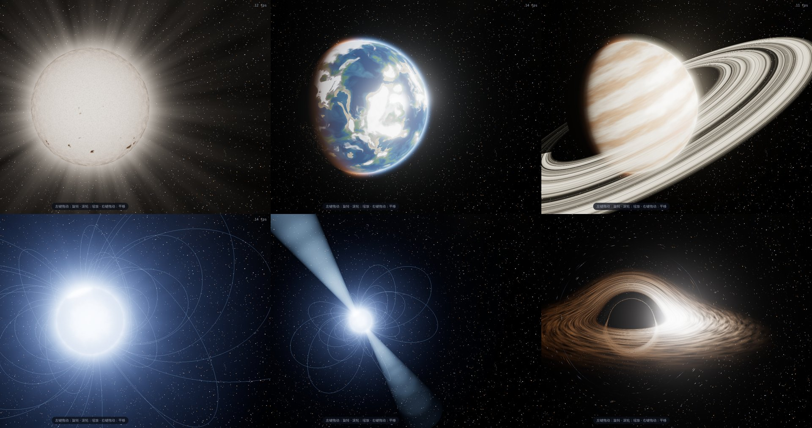
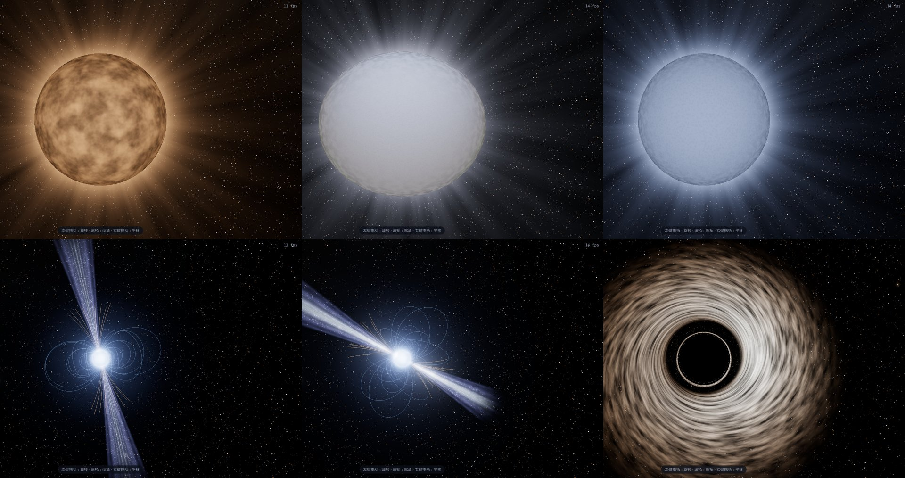
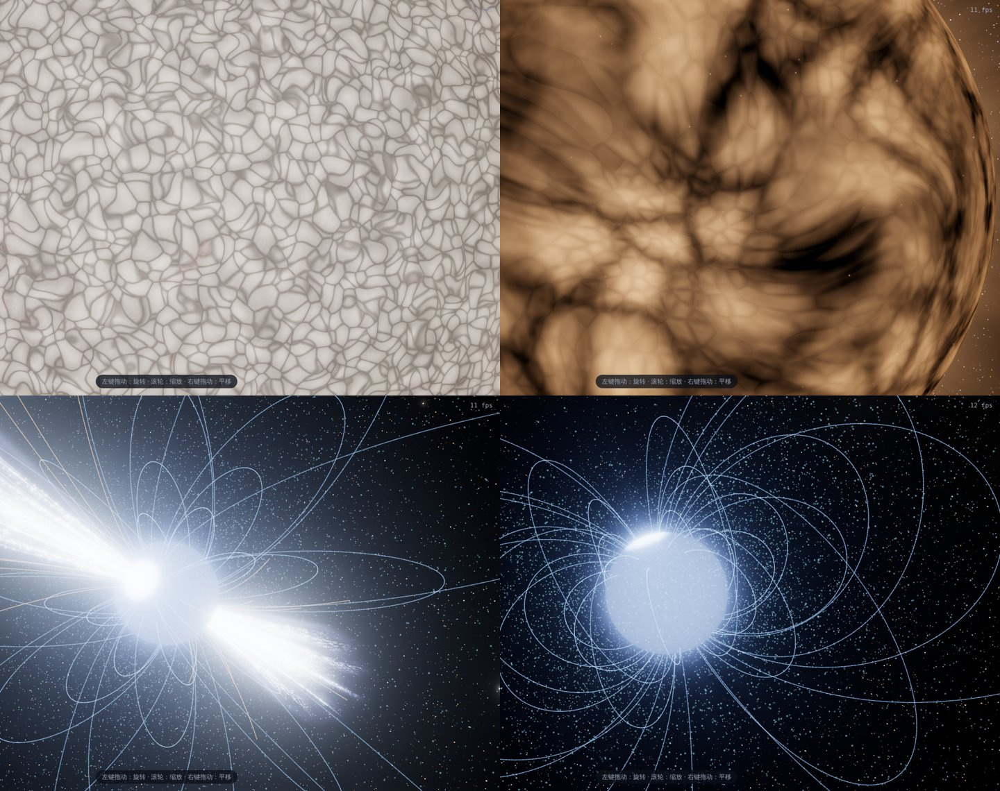

# Stars · 星体仿真渲染

> When you are depressed, just see the stars

在浏览器里实时渲染**恒星、行星、脉冲星和黑洞**，力求在物理上“说得通”，并且可以用鼠标/触屏拖动旋转、缩放查看。

**在线预览：https://verapyuyi.github.io/Stars/**

A physically-inspired, interactive WebGL renderer for stars, planets, pulsars and black holes. Runs in any modern browser — no install needed.



## 功能

| 天体 | 渲染要点 |
| --- | --- |
| 恒星 | 黑体辐射颜色（2500–40000 K，自动显示光谱型）、临边昏暗、米粒组织、星斑、光斑、日冕光晕 |
| 行星 | 类地行星（程序生成大陆/海洋/冰盖、海面高光、云层、夜面城市灯光、指数大气散射边缘）；水星型环形山、金星型硫酸云、火星型红色荒漠与极冠；木星、土星、天王星、海王星各自的云带配色、自转轴倾角（天王星侧躺、金星倒转）与带行星投影的光环 |
| 小行星带 | 一万多颗小行星各走各的开普勒轨道（内圈比外圈转得快），刻出柯克伍德空隙，有轨道倾角与偏心率；近处的岩块是按太阳方向打光的不规则岩体，谷神星、灶神星更大 |
| 脉冲星 | 10⁶ K 中子星表面与磁极热斑；体积光线步进的辐射束（核心 + 空心锥 + 外锥，“火花旋转木马”漂移子脉冲），按真实周期计算**光速圆柱**与光行时延，毫秒脉冲星的光束弯成阿基米德螺旋；光束扫过视线时出现短促的衍射星芒闪光；实时**脉冲轮廓**图与占空比 |
| 黑洞 | 逐像素**史瓦西测地线光线追踪**：事件视界阴影、光子环、吸积盘引力透镜、背景星空畸变、相对论多普勒集束与引力红移 |

### 两种模式

- **真实天体漫游**（默认）：27 站，**从太阳出发由近到远**：先游太阳系（太阳 → 水星 → 金星 → 地球 → 火星 → 小行星带 → 木星 → 土星 → 天王星 → 海王星，行星都在绕太阳公转，镜头会跟着行星走），再按离地球的距离经比邻星……一直飞到 5500 万光年外的 M87*。所有天体都按真实自转周期**自转**（加速并压缩了范围：木星约 15 秒一圈，参宿四约 37 秒一圈）。**一路连续飞行，不在站点停留**：镜头沿一条穿过所有站点的平滑曲线（向心 Catmull–Rom）飞，经过每个天体时放慢、看着它掠过，然后转向下一站；镜头有惯性，转向速度有上限，经过小行星时不会甩头。进入漫游时预先编译所有着色器，第一次见到某类天体时不会卡一下（仿照作者主页的“星系飞行”）。**飞行时长随真实距离的对数增长**（3–20 秒），途中显示距离读数（太阳系内为距太阳的天文单位，系外为距地球的光年）和星际星尘拖影。**手动驾驶**：滚轮（或按住屏幕下方的“前进 / 后退”、↑ ↓ 键）沿航线连续前进或后退，可以停在两站之间，也可以倒回去；速度上限由这一段的真实距离决定，停在天体附近时会自动靠过去停好。空格或“▶ 自动漫游”从当前位置一路飞到终点；← → 或点击航线上的站点则飞到那一站停下。停靠时可拖动旋转，Ctrl + 滚轮缩放。远处的天体显示为一串光点。**详细信息只在需要时出现**：左上角只显示最近天体的名字；**点击画面里的天体**（或“ⓘ 介绍”）才展开介绍，并飞到它跟前停下（自定义模式的物理说明同样默认折叠）。
- **自定义模拟**：恒星、行星、脉冲星、黑洞四类天体的所有参数都可自由调节。漫游中的任一天体都可以“用这组参数自定义”带到这里继续改。

### 知名天体（真实观测数据）

漫游航线上的天体及其数据卡片：

- **太阳系**：水星、金星、地球、火星、小行星带、木星、土星、天王星、海王星（半径、轨道、公转与自转周期等数据卡片）
- **恒星**：太阳、参宿四、心宿二、参宿七、天津四、天狼星 A、织女星、牛郎星、轩辕十四、比邻星（含快速自转扁球与重力昏暗、红超巨星的巨型对流元胞）
- **脉冲星**：蟹状星云脉冲星、船帆座脉冲星、PSR B1919+21、PSR B0943+10、PSR J1748−2446ad
- **黑洞**：M87*、人马座 A*、天鹅座 X-1（按观测倾角放置镜头）

链接可直接定位到某一站，例如 `#tour/betelgeuse`、`#tour/crab`；自定义模式为 `#custom/star` 等。



操作：左键拖动旋转 · 滚轮缩放 · 右键拖动平移（触屏：单指旋转、双指缩放）。

### 画质与细节

- 多重采样抗锯齿的 HDR 后期管线，画质三档（标准 / 高 / 极致超采样）。
- 恒星按像素做解析光线–球求交（不再是三角网格），轮廓与法线完全光滑，没有多边形剖分痕迹；表面用带域扭曲的 Voronoi 细胞噪声生成米粒组织（亮的上升流 + 暗的下沉通道），细节随缩放逐级出现；红超巨星有“巨型元胞 + 小元胞”的层级结构。
- 日珥为体积光线步进：宁静日珥是由细丝组成的“帘幕”，活动日珥是扭曲的磁绳拱，只在临边外发出 Hα 粉红光（只在太阳、比邻星这类有磁活动的冷星上出现）。
- 粒子：帕克螺旋星风；脉冲星沿开放磁力线外流的带拖尾粒子；磁层里在镜点间来回弹跳的被俘粒子（超出光速圆柱的闭合磁力线自动消失）。
- 磁力线为抗锯齿粗线；行星地形有凹凸光照；黑洞测地线改用蛙跳积分。



## 快速开始

```bash
npm install
npm run dev      # 打开 http://localhost:5173
npm run build    # 生成静态文件到 dist/
```

推送到 `main` 后，GitHub Actions 会自动构建并发布到 GitHub Pages（见 `.github/workflows/deploy.yml`）。

需要支持 WebGL2 的浏览器。黑洞场景计算量较大，可在面板里调低“光线追踪质量”。

## 技术栈

- [Three.js](https://threejs.org/) + 自定义 GLSL 着色器
- TypeScript + [Vite](https://vite.dev/)
- 后期：UnrealBloom 辉光 + ACES 色调映射（HDR 线性光照）

```
src/
  main.ts            渲染器、相机控制、UI
  sky.ts             全屏背景：程序星空 / 黑洞光线追踪
  shaders/common.ts  噪声、黑体颜色等共享 GLSL
  objects/           各类天体（star / planet / pulsar / blackHole / asteroidBelt / glow / flare）
  tour/              漫游：站点数据、航线布局、镜头飞行、界面
```

## 物理近似说明

本项目追求“看起来对、原理上对”，而不是科研级精度。目前的主要近似：

- 颜色使用黑体温度 → RGB 拟合，未做完整光谱积分。
- 恒星表面纹理是程序噪声，不是磁流体模拟。
- 大气为单次散射的解析近似。
- 黑洞为不自旋的史瓦西黑洞，吸积盘为几何薄盘。
- 脉冲星表面暂未考虑引力光线弯曲；光束为几何模型，不是等离子体模拟。
- 太阳系不按比例：行星轨道半径按 a^0.6 压缩，行星画得比实际大得多，公转周期按 √P 压缩（地球 4 分钟一圈）；轨道为圆形且共面。小行星带的密度被大幅夸大（真实的小行星之间平均相隔上百万公里）。行星表面为程序生成，并非真实地图。

## 路线图

- [ ] 克尔（自旋）黑洞与更真实的吸积盘（体积、喷流）
- [ ] 脉冲星表面引力光线弯曲（可见超过半个表面）
- [x] 基于真实数据的预设
- [ ] 白矮星（天狼星 B）
- [x] 太阳系行星与小行星带
- [ ] 真实星表背景（如 Hipparcos / Gaia 亮星）
- [ ] 双星、潮汐瓦解等动态场景
- [ ] 英文界面

欢迎 Issue 和 PR！

## License

[MIT](LICENSE)
